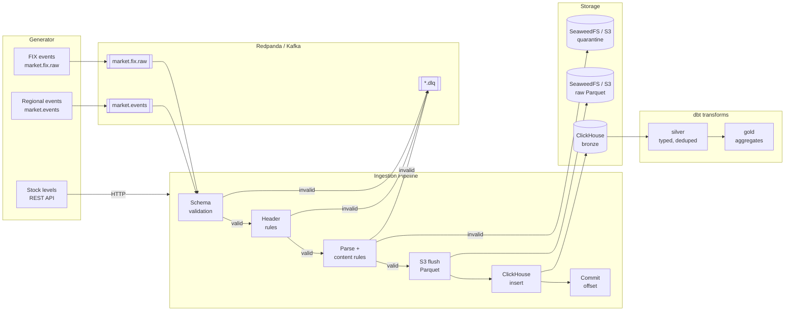
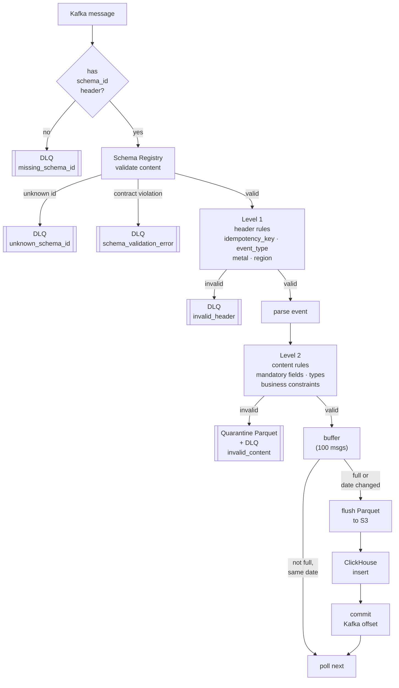

# metals-data-platform

A local proof-of-concept data platform for commodity market data, built to explore ingestion, replay, and idempotency patterns. Runs on a laptop with Docker.

## Overview

A generator produces synthetic trading data. A pipeline ingests it via Kafka, stores raw events as immutable Parquet files in object storage, loads them into ClickHouse, and transforms them through bronze → silver → gold layers using dbt.

| Data                             | Shape                   | Transport        |
|----------------------------------|-------------------------|------------------|
| Trades (FIX messages)            | unstructured text       | Kafka / Redpanda |
| Trade details                    | semi-structured JSON    | Kafka / Redpanda |
| Warehouse and barge stock levels | structured              | REST API         |
| Barge positions                  | geospatial, batch files | Kafka / Redpanda |

## Architecture





## Architectural decisions

### Idempotency

Every event carries a natural business key (`execution_id`). Duplicates and re-deliveries are handled at two levels:

- **Transport**: Kafka at-least-once delivery with manual offset commit — offset is committed only after successful S3 write and ClickHouse insert
- **Storage**: bronze uses MergeTree (not ReplacingMergeTree) — deduplication is explicit, handled in the silver layer via `QUALIFY ROW_NUMBER() OVER (PARTITION BY execution_id ...)`

This makes deduplication visible and testable rather than relying on engine-level magic.

### Replay

Raw events are written as immutable Parquet files in S3, partitioned by topic and event date. Each flush produces a new uniquely-named file — nothing is ever overwritten:

```
{topic}/{YYYY-MM-DD}/{timestamp_ms}.parquet   ← written by pipeline (append)
{topic}/{YYYY-MM-DD}/compacted.parquet        ← written by compaction job (daily)
```

A nightly compaction job (`ingestion/compaction.py`) merges all flush files for the previous day into a single `compacted.parquet` and deletes the originals. This keeps S3 tidy without sacrificing immutability during the day.

Any downstream table (silver, gold) can be fully rebuilt by truncating it and replaying from bronze:
```bash
# truncate silver
curl -X POST "http://localhost:8123/" -u "default:clickhouse" --data "TRUNCATE TABLE silver.fix_events"
# rebuild
dbt run
```

**Production compaction:** run as a cron job at 00:05 UTC daily (5 minutes after midnight to let any late-arriving events land):
```bash
5 0 * * * cd /app && python -m ingestion.compaction
```
Or for a specific date:
```bash
make compact DATE=2026-10-07
```

### Delivery guarantee

The pipeline commits Kafka offsets only after data has been written to both S3 and ClickHouse. If either write fails, the offset is not committed and the messages are reprocessed on restart. This guarantees at-least-once delivery end-to-end.

### Data lineage

Every row in every layer carries `source_file` (S3 path of the Parquet file it came from) and `pipeline_version`. This makes it possible to trace any row back to its origin and understand which pipeline version produced it.

## Ingestion pipeline

The pipeline runs as a single orchestrated process (`python -m ingestion.pipeline`). It manages three threads:

- **Worker threads** (one per topic): consume Kafka, parse, buffer, flush to S3, insert into ClickHouse, commit offset
- **dbt thread**: runs `dbt run` every 30 seconds, rebuilding all silver and gold models from bronze

```
Kafka poll → parse → buffer (100 messages) → S3 flush → ClickHouse insert → commit offset
                                                                          ↑
                                              dbt thread (every 30 sec) ──┘ silver + gold
```

**End-to-end latency (event → visible in gold):** ~35 seconds worst case (buffer fill ~5 sec + dbt interval 30 sec).

**Partition strategy:**
- `market.fix.raw` — 4 partitions, key: `metal_id`
- `market.events` — 4 partitions, key: `metal_id_region`
- 2 active partitions per topic now, 2 reserved for horizontal scaling

**Error handling:**
- Graceful shutdown on SIGINT/SIGTERM: clean + quarantine buffers flushed before exit
- Worker crash recovery: automatic restart after 5 seconds
- S3 write retry: up to 3 attempts with exponential backoff
- Offset commit only after successful S3 + CH write

**Validation and routing:**

Every message passes two validation levels before it reaches the clean data path:

- **Level 1 — schema + header rules**: schema contract (via Schema Registry) is validated first, then business rules on headers (known instruments, regions, event types, idempotency key format). Failures → DLQ.
- **Level 2 — content rules**: mandatory fields, field types, and business constraints (price > 0, valid side, known currency). Failures → quarantine Parquet + DLQ so the producer can be notified and the data is preserved for inspection.

Unknown fields and headers are intentionally ignored — tolerance for extra data is the correct strategy for schema evolution.

See [`docs/contracts/`](docs/contracts/) for the full rules per event type.

**S3 layout:**
```
{topic}/{YYYY-MM-DD}/{timestamp_ms}.parquet     ← clean events (pipeline)
{topic}/{YYYY-MM-DD}/compacted.vN.parquet       ← compacted (daily job)
quarantine/{topic}/{YYYY-MM-DD}/{ts}.parquet    ← content-invalid events
```

**Error injection (generator):**

The generator intentionally corrupts ~5% of messages (one error type per message) to exercise the validation paths end-to-end. All duplicates of a corrupted message carry the same corruption — matching real at-most-once producer retry semantics.

Schema IDs are registered once at setup:
```bash
make register-schemas
```

DLQ messages carry a `dlq_reason` header for inspection:

| Reason prefix | Source |
|---|---|
| `missing_schema_id` | no schema_id header |
| `unknown_schema_id:<id>` | schema not in registry |
| `schema_validation_error:<msg>` | jsonschema contract violation |
| `invalid_header:<field>:<value>` | header business rule |
| `missing_header:<field>` | required header absent |
| `invalid_content:<rule>` | content business rule → also in quarantine |

## Data models

Transformations are managed with **dbt** in `transforms/`. Three layers:

**Bronze** — raw data as-is from Parquet. No casting, no renaming. Lineage columns `source_file` and `pipeline_version` added at load time.

**Silver** — typed, renamed, deduplicated. FIX protocol tags mapped to human-readable names. Timestamps parsed from FIX format (`YYYYMMDD-HH:MM:SS.mmm`). Deduplication via `QUALIFY ROW_NUMBER()` on natural key.

**Gold** — aggregates for analytics, rebuilt automatically every 30 seconds by the pipeline's dbt thread:

| Model | Description |
|-------|-------------|
| `fix_daily_summary` | Daily FIX trade aggregates per instrument and side |
| `fix_hourly_summary` | Hourly FIX aggregates with time-of-day bucket |
| `regional_events_daily_summary` | Daily regional aggregates per instrument, region, warehouse |
| `regional_events_hourly` | Hourly regional aggregates with time-of-day bucket |
| `fix_region_prices_daily` | Global FIX price vs regional price with spread |
| `events_lineage` | Source Parquet files per date and table for lineage tracking |

### conditions field versioning

Currently `conditions` is a single JSON object per event (one warehouse). Silver flattens it to `region`, `warehouse_id`, `warehouse_city`.

The intended production shape is a list of objects (multiple warehouses per event). Migration path:

**Phase 1 — dual read in silver (backwards compatible):**
- Silver detects schema version via `schema_version` from bronze
- `v1`: flat extraction via `JSONExtractString`
- `v2`: array extraction via `JSONExtract` + `arrayMap`
- Both versions coexist, no downstream breakage

**Phase 2 — generator migration:**
- Generator emits `conditions` as JSON array with `schema_version: 2`
- Bronze unchanged — stores raw JSON as-is
- Silver processes v1 and v2 simultaneously

**Phase 3 — cutover:**
- Drop v1 branch from silver once all bronze data is v2
- Replay from bronze to reconstruct silver fully

## Performance

Measured on a laptop (Apple M-series, Docker).

**Kafka → ClickHouse (pipeline):**
| Metric | Value |
|--------|-------|
| Throughput — backlog catch-up | ~265–446 msg/sec |
| Throughput — steady state | ~40 msg/sec total (~20 per topic) |
| Message parse time | < 0.2 ms |
| S3 write (100 messages, ~7 KB) | 5–15 ms |
| ClickHouse insert (100 rows) | 55–70 ms |
| Schema Registry validation overhead | negligible (cached after first lookup) |

**End-to-end latency:**
| Layer | Latency |
|-------|---------|
| Event → bronze (ClickHouse) | ~2–5 sec (buffer fill time) |
| Event → gold (dbt) | ~35 sec worst case (buffer + dbt interval) |
| Backlog catch-up → bronze | < 100 ms per batch |

Bronze latency is dominated by buffer fill time (100 messages). Gold latency is dominated by the 30-second dbt interval — lower it in `dbt_executor` if fresher analytics are needed.

## Quick start

**1. Start the stack**
```bash
make up
```

**2. Create topics**
```bash
make topics
```

**3. Start the generator** (terminal 1)
```bash
make generator
```

**4. Start the pipeline** (terminal 2)
```bash
python -m ingestion.pipeline
```

**5. Run compaction** (merges today's flush files into one, deletes originals)
```bash
make compact DATE=2026-10-08
```

**6. Run dbt transformations**
```bash
cd transforms && dbt run
```

**6. Check Redpanda Console**

Open http://localhost:8080

**7. Verify data in object storage**
```bash
aws --endpoint-url http://localhost:8333 s3 ls s3://raw-events/ --recursive
```

**8. Generate data lineage diagram**
```bash
make lineage
```
Opens `tools/lineage.puml` in PyCharm with the PlantUML plugin to see model dependencies and grain.

**9. Tear down**
```bash
make down
```

## Events structure

### FIX event

```json
{
  "topic": "market.fix.raw",
  "key": "AH",
  "value": "8=FIX.4.4|35=8|34=2052|52=20261005-21:12:26.047|17=EX-002052|55=AH|54=1|32=33|31=2664.29|60=20261005-21:04:16.047|",
  "headers": [
    {"key": "event_type", "value": "trade_execution_report"},
    {"key": "schema_version", "value": "1"},
    {"key": "source", "value": "synthetic_fix"},
    {"key": "content_type", "value": "text/plain"},
    {"key": "idempotency_key", "value": "EX-002052"}
  ],
  "timestamp": 1791234746047,
  "partition": 0,
  "offset": 9
}
```

### Regional event

```json
{
  "topic": "market.events",
  "key": "PB_ME",
  "value": "{\"event_type\": \"regional_price_quote\", \"schema_version\": 1, \"execution_id\": \"EX-ME-2039\", \"instrument\": \"PB\", \"side\": \"sell\", \"quantity\": 24, \"price\": 2196.44, \"currency\": \"USD\", \"event_timestamp\": \"20261005-21:11:47.968\", \"conditions\": {\"region\": \"Middle East\", \"warehouse\": {\"warehouse_id\": \"WH_DBX\", \"city\": \"Dubai\"}}}",
  "headers": [
    {"key": "event_type", "value": "regional_price_quote"},
    {"key": "schema_version", "value": "1"},
    {"key": "source", "value": "synthetic_regional_market"},
    {"key": "content_type", "value": "application/json"},
    {"key": "idempotency_key", "value": "EX-ME-2039"}
  ],
  "timestamp": 1791234707968,
  "partition": 0,
  "offset": 9
}
```

## Roadmap

- [x] Data generator
- [x] Kafka / Redpanda locally
- [x] Ingestion pipeline — Kafka → S3 → ClickHouse bronze
- [x] Schema Registry + DLQ
- [x] Immutable Parquet with daily compaction
- [x] Silver layer (dbt)
- [x] Gold layer (dbt) — 6 models, auto-refreshed every 30 sec via pipeline
- [x] dbt tests — 78 tests across silver and gold
- [x] Data lineage diagram (PlantUML, auto-generated from dbt manifest)
- [x] Two-level validation — schema + header rules (DLQ) + content rules (quarantine + DLQ)
- [x] Error injection in generator (~5% corrupt messages for end-to-end validation testing)
- [ ] Spark and Iceberg experiments
- [ ] API data processing
- [ ] Superset dashboards
